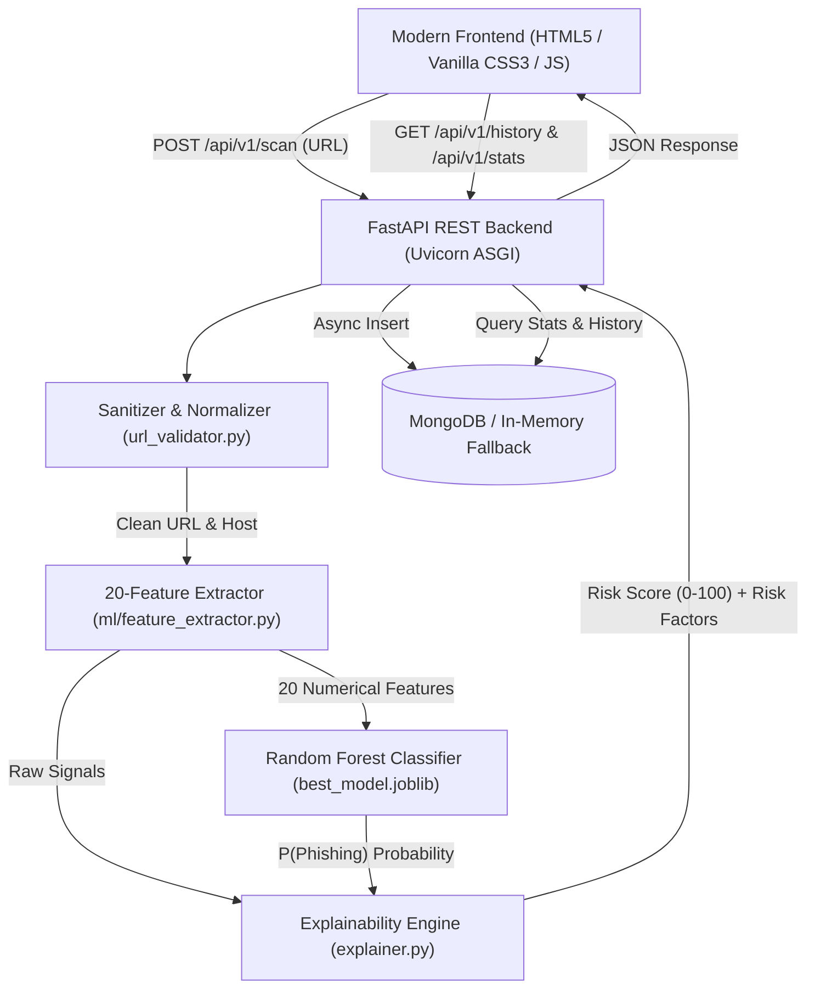

# PhishGuard AI – Intelligent Phishing URL & Fake Website Detection System

[](https://python.org)
[](https://fastapi.tiangolo.com)
[](https://scikit-learn.org)
[](https://mongodb.com)
[](LICENSE)

An end-to-end college-level cybersecurity and machine learning application that detects phishing URLs, spoofed domains, and fraudulent websites in real time using 20 mathematical and structural heuristics paired with a Scikit-Learn classification engine.

---

## 1. Project Overview

PhishGuard AI provides individuals, security analysts, and enterprise users with an automated threat analysis platform. By inputting any suspected web address, users receive a multi-layered security assessment comprising:
- A continuous **Risk Score** (0 to 100).
- A categorical classification (**Low Risk**, **Suspicious**, or **High Risk / Phishing**).
- An **Explainable AI (XAI)** breakdown of specific threat indicators (e.g. brand keywords, excessive subdomains, high entropy, raw IP address in host).
- A comprehensive **20-Feature Inspector** detailing low-level lexical, structural, and network parameters.

---

## 2. Problem Statement

Phishing remains the primary initial attack vector in cybercrime, accounting for the majority of data breaches, credential harvesting incidents, and ransomware infections worldwide. Traditional blacklist-based defenses (such as DNS sinkholes or static blocklists) suffer from significant limitations:
- **Zero-Hour Evasion**: Newly registered malicious domains and disposable phishing links often remain active for hours before appearing on global blocklists.
- **Obfuscation Tactics**: Threat actors routinely bypass signature checks using IP address hosting, subdomain nesting, character obfuscation (Punycode / IDN homograph attacks), URL shorteners, and path redirection tokens.
- **Lack of Explainability**: Automated filters often return binary block/allow decisions without explaining the structural anomalies that triggered the alert.

**PhishGuard AI** addresses these challenges by analyzing the structural, syntactic, and domain-level anatomy of URLs in real time using machine learning—detecting threats proactively without waiting for third-party blacklist updates or relying on expensive external APIs.

---

## 3. Key Features

1. **Robust URL Sanitization & Normalization**: Resilient URL parser that handles missing protocols, Unicode Punycode (`xn--`), IPv4/IPv6 addresses, non-standard ports, and malformed inputs without crashing.
2. **20-Dimensional Heuristic Extractor**: Evaluates lexical, structural, and domain-level metrics natively in Python without third-party network lookups.
3. **Multi-Model Machine Learning Pipeline**: Evaluates Logistic Regression, Decision Tree, and Random Forest models with anti-leakage scaling and balanced class weights.
4. **Calibrated 0–100 Risk Score**: Continuous probability mapped to intuitive risk categories:
   - `0 – 34`: **Low Risk (Likely Legitimate)**
   - `35 – 69`: **Moderate Risk (Suspicious)**
   - `70 – 100`: **High Risk (Likely Phishing)**
5. **Explainable AI (XAI) Diagnostic Engine**: Translates complex feature vectors into human-readable risk factors with severity indicators (`HIGH`, `MEDIUM`, `LOW`).
6. **Scan Audit Trail & History**: Searchable, filterable historical record of all evaluated URLs with one-click rescanning and deletion.
7. **Threat Telemetry Dashboard**: Real-time aggregated statistics displaying total scans, detection ratios, average risk score, and top triggered threat indicators.
8. **Asynchronous REST API**: High-performance FastAPI backend with Pydantic validation, interactive OpenAPI/Swagger docs (`/docs`), and CORS middleware.
9. **MongoDB Persistence with In-Memory Fallback**: Asynchronous database storage with an automatic in-memory buffer fallback (zero crash guarantee if MongoDB is offline).
10. **Modern Cyber-Dark Glassmorphism Interface**: Single-page application built with Vanilla HTML5, CSS3, and ES6 JavaScript featuring an animated SVG radial risk gauge.

---

## 4. System Architecture



---

## 5. Technology Stack

| Layer | Technologies | Purpose |
|---|---|---|
| **Frontend** | HTML5, Vanilla CSS3 (Glassmorphism), Vanilla JavaScript (ES6+), SVG | Interactive single-page interface, animated radial gauge, responsive telemetry |
| **Backend API** | Python 3.10+, FastAPI, Uvicorn, Pydantic | Asynchronous REST endpoints, request validation, static web hosting |
| **Machine Learning** | Scikit-learn, Pandas, NumPy, Joblib | Model training, anti-leakage scaling pipelines, feature engineering, serialization |
| **Database** | MongoDB, Motor (Async Driver), PyMongo | Audit logs, scan history, threat analytics with seamless in-memory fallback |
| **Testing** | Pytest, HTTPX, FastAPI TestClient | Automated test suite covering feature extraction, validation, and REST routes |

---

## 6. Machine Learning Approach

### Feature Engineering (20 Extracted Features)
The feature extraction engine (`ml/feature_extractor.py`) computes 20 numerical parameters:

| # | Feature Key | Category | Description & Cybersecurity Significance |
|---|---|---|---|
| 1 | `url_length` | Lexical | Total character length. Phishing URLs tend to be unusually long to conceal destination host. |
| 2 | `hostname_length` | Lexical | Length of the domain name / FQDN. |
| 3 | `path_length` | Lexical | Length of directory path components. |
| 4 | `query_length` | Lexical | Length of query string parameters carrying tracking tokens. |
| 5 | `count_dots` | Structural | Count of `.` characters; excessive dots indicate subdomain spoofing. |
| 6 | `count_hyphens` | Structural | Count of `-` characters; common in brand squatting (`paypal-security-center.com`). |
| 7 | `count_digits` | Structural | Count of numeric digits (0–9) across URL. |
| 8 | `count_special_chars`| Structural | Count of non-alphanumeric characters. |
| 9 | `has_https` | Protocol | 1 if HTTPS, 0 if HTTP (unencrypted credential submission). |
| 10 | `has_at_symbol` | Structural | 1 if `@` is present (exploits RFC 3986 basic auth spoofing). |
| 11 | `count_at` | Structural | Total count of `@` symbols. |
| 12 | `has_ip` | Network | 1 if hostname is a raw IPv4/IPv6 address (bypasses domain reputation). |
| 13 | `subdomain_count` | Structural | Depth of subdomain nesting levels disguising real landing domain. |
| 14 | `has_suspicious_keywords` | Content | 1 if target banking/auth keywords (`login`, `verify`, `account`, etc.) are detected. |
| 15 | `suspicious_keyword_count` | Content | Total tally of matched phishing lure keywords. |
| 16 | `has_suspicious_tld` | Domain | 1 if TLD is in known high-abuse extensions (`.xyz`, `.top`, `.buzz`, `.club`, etc.). |
| 17 | `is_shortened` | Domain | 1 if domain matches URL shortening services (`bit.ly`, `tinyurl.com`, etc.). |
| 18 | `has_non_standard_port` | Network | 1 if non-standard web port (not 80 or 443) is explicitly declared. |
| 19 | `has_double_slash_redirect` | Security | 1 if `//` appears inside URL path (client-side redirection trick). |
| 20 | `url_entropy` | Mathematical | Shannon character entropy detecting algorithmically generated domains (DGA). |

### Multi-Model Benchmarking
The training pipeline (`ml/train_models.py`) evaluates three candidate architectures:
1. **Logistic Regression**: Linear baseline wrapped inside a Scikit-Learn `Pipeline` with `StandardScaler` to prevent data leakage.
2. **Decision Tree**: Non-linear tree baseline (`max_depth=15`) with balanced class weights.
3. **Random Forest**: Ensemble bagging classifier (100 estimators, `max_depth=15`, `class_weight='balanced'`) selected for deployment due to its superior variance reduction and non-linear feature interaction modeling.

---

## 7. Project Structure

```
phishguard-ai/
├── backend/
│   ├── app/
│   │   ├── main.py                   # FastAPI app, CORS, routes & static frontend mount
│   │   ├── config.py                 # App configuration & environment loader
│   │   ├── database.py               # Async MongoDB client with in-memory fallback
│   │   ├── models/                   # Pydantic validation schemas (scan, stats)
│   │   ├── routes/                   # API endpoint handlers (scan, history, stats, health)
│   │   ├── services/                 # Business logic, predictor, and explainer
│   │   └── utils/                    # Regex URL validation & heuristics constants
│   ├── ml/
│   │   ├── dataset/                  # Dataset generator & CSV data
│   │   ├── saved_models/             # Model artifacts (rf_model.joblib)
│   │   ├── train.py                  # Training script
│   │   └── evaluate.py               # Model inspection utility
│   ├── tests/                        # Backend unit & integration tests
│   └── requirements.txt              # Pinned backend dependencies
├── frontend/
│   ├── index.html                    # Single-Page Application (Scanner, History, Dashboard, Architecture)
│   ├── css/
│   │   ├── styles.css                # Design system, cyber dark theme, typography
│   │   └── components.css            # Radial gauge, status pills, tables, metric cards
│   ├── js/
│   │   ├── api.js                    # Fetch client for backend REST API
│   │   ├── app.js                    # Main coordinator, tab navigation, health polling
│   │   ├── scanner.js                # URL submission, animated SVG gauge, feature inspection
│   │   ├── history.js                # Scan history table, search, filtering, and deletion
│   │   └── dashboard.js              # Telemetry widgets and distribution bars
│   └── assets/
│       └── logo.svg                  # Vector cyber shield brand mark
├── ml/
│   ├── feature_extractor.py          # Standalone 20-feature extraction module
│   ├── train_models.py               # Multi-model benchmarking & training pipeline
│   ├── dataset/
│   │   └── phishing_urls.csv         # Balanced benchmark dataset (4,000 samples)
│   └── saved_models/
│       ├── best_model.joblib         # Serialized winning classifier
│       ├── feature_names.json        # Ordered feature names metadata
│       └── model_comparison.json     # Multi-model evaluation benchmark metrics
├── tests/
│   └── test_feature_extractor.py     # Unit test suite for feature extraction
├── .env.example                      # Sample configuration template
├── .gitignore                        # Git exclusion rules
└── README.md                         # Project documentation
```

---

## 8. Installation & Setup

### Prerequisites
- Python 3.10 or higher
- MongoDB (optional; system automatically defaults to in-memory mode if MongoDB is offline)

### Step 1: Clone the Repository
```bash
git clone https://github.com/YOUR_USERNAME/phishguard-ai.git
cd phishguard-ai
```

### Step 2: Install Dependencies
```bash
cd backend
pip install -r requirements.txt
cd ..
```

---

## 9. How to Run Locally

### Start the Application (Backend + Frontend)
From the project root directory, start the FastAPI ASGI server:

```bash
cd backend
python3 -m uvicorn app.main:app --host 127.0.0.1 --port 8000 --reload
```

- **Web Application UI**: Open [http://127.0.0.1:8000/](http://127.0.0.1:8000/) in any modern browser.
- **Interactive OpenAPI / Swagger Documentation**: Open [http://127.0.0.1:8000/docs](http://127.0.0.1:8000/docs).
- **Alternative ReDoc Documentation**: Open [http://127.0.0.1:8000/redoc](http://127.0.0.1:8000/redoc).

---

## 10. API Specification & Endpoints

| Method | Endpoint | Description |
|---|---|---|
| `POST` | `/api/v1/scan` | Analyzes a URL and returns 0–100 risk score, classification, features, and explanations. |
| `GET` | `/api/v1/history` | Returns paginated list of previous scans with optional search and classification filters. |
| `GET` | `/api/v1/scan/{id}` | Retrieves full diagnostic report for a specific scan. |
| `DELETE` | `/api/v1/history/{id}` | Removes a scan record from history. |
| `GET` | `/api/v1/stats` | Returns aggregated metrics, threat ratios, and top triggered threat indicators. |
| `GET` | `/api/v1/health` | System health check (API status, ML model loaded, MongoDB connection status). |

---

## 11. Example Usage

### A. Scanning via cURL
```bash
curl -X POST http://127.0.0.1:8000/api/v1/scan \
  -H "Content-Type: application/json" \
  -d '{"url": "http://paypal-security-verification.xyz/login.php"}'
```

#### Example Response (200 OK):
```json
{
  "status": "success",
  "data": {
    "id": "6aaa6671db0ca8c941833d1b",
    "url": "http://paypal-security-verification.xyz/login.php",
    "domain": "paypal-security-verification.xyz",
    "risk_score": 100,
    "classification": "Phishing",
    "confidence": 1.0,
    "features": {
      "url_length": 49,
      "hostname_length": 32,
      "has_ip": 0,
      "count_dots": 2,
      "count_hyphens": 2,
      "has_https": 0,
      "has_suspicious_keywords": 1,
      "suspicious_keyword_count": 4,
      "has_suspicious_tld": 1,
      "url_entropy": 4.3191
    },
    "explanation": {
      "summary": "High risk URL exhibiting 3 critical threat indicator(s). Strong evidence of deceptive domain structure or brand impersonation.",
      "risk_factors": [
        {
          "factor": "High-Risk TLD (.xyz)",
          "severity": "HIGH",
          "description": "The top-level domain '.xyz' is frequently associated with disposable infrastructure and spam/phishing campaigns."
        },
        {
          "factor": "Security / Credential Keywords",
          "severity": "HIGH",
          "description": "Contains 4 sensitive keyword(s) commonly used in credential harvesting lures."
        },
        {
          "factor": "Unencrypted Protocol (HTTP)",
          "severity": "MEDIUM",
          "description": "URL does not use HTTPS. Any submitted credentials can be intercepted in cleartext."
        }
      ]
    },
    "disclaimer": "This assessment is a probabilistic estimate generated via machine learning and structural heuristic analysis. It does not constitute a 100% guarantee of safety.",
    "scanned_at": "2026-09-16T09:50:41.743520Z"
  }
}
```

### B. Feature Extraction via Python
```python
from ml.feature_extractor import extract_features

features = extract_features("http://192.168.1.1:8080/bank/login")
print(f"Host: {features['hostname']}, Raw IP: {features['has_ip']}, Keywords: {features['detected_keywords']}")
```

---

## 12. Automated Testing

The project includes unit tests for feature extraction, URL validation, and full REST API integration.

```bash
# 1. Run Feature Extractor Unit Tests
PYTHONPATH=. python3 -m pytest tests/ -v

# 2. Run Backend & API Integration Tests
cd backend && python3 -m pytest tests/ -v && cd ..
```

---

## 13. Future Improvements

1. **WHOIS & Domain Age Integration**: Incorporate domain creation date lookups; newly registered domains ($< 30$ days) are statistically high-risk.
2. **SSL/TLS Certificate Inspection**: Check certificate issuer (e.g. Let's Encrypt vs. Extended Validation) and certificate age.
3. **Visual Brand Similarity (OCR / Deep Learning)**: Render headless webpage screenshots and apply Convolutional Neural Networks (CNNs) to detect visual brand impersonation (e.g., matching PayPal/Google logos).
4. **Active Content Analysis**: Inspect webpage DOM for deceptive password fields, external iframe injections, and hidden redirect scripts.

---

## 14. Ethical Disclosure & Safety Policy

PhishGuard AI adheres to core cybersecurity threat intelligence principles:

> [!WARNING]
> **Probabilistic Assessment Disclaimer**: Automated machine learning models evaluate structural patterns and statistical likelihoods; **they can never provide an absolute 100% guarantee of website safety.** A classification of *Low Risk* indicates conformity to benign structural patterns, not certified immunity. Always exercise personal vigilance and verify authenticity through official channels before entering sensitive credentials.
